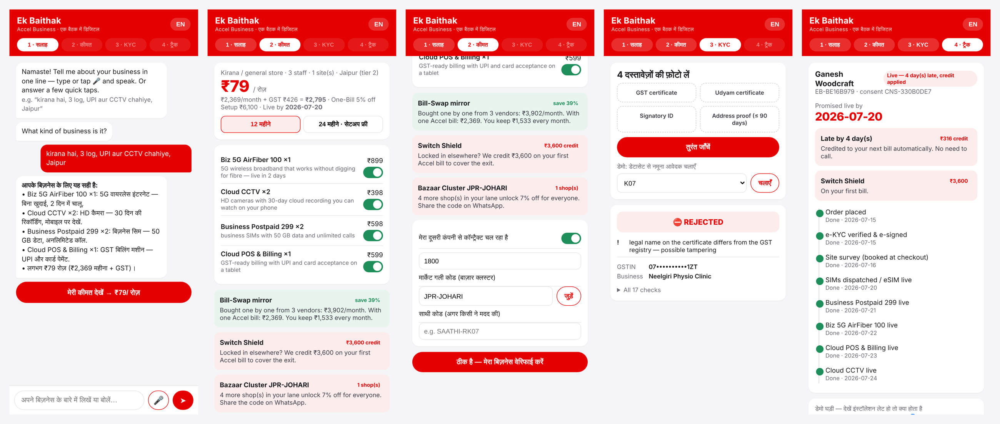
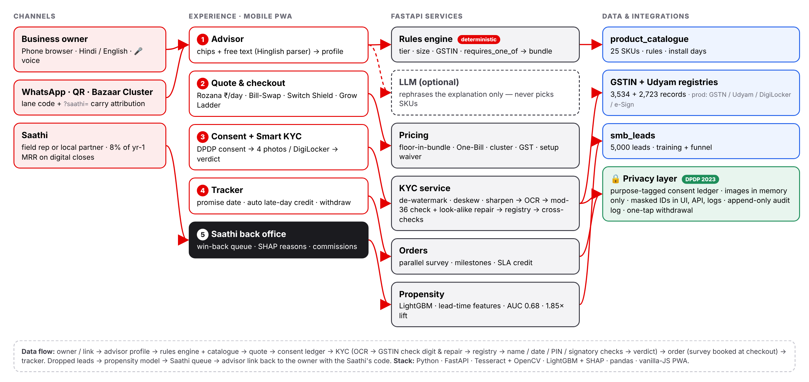

# Ek Baithak — digital in one sitting

**Team Matrix** · Rahul Kumar · Ravi Kishan · VIT Vellore
Airtel SYNC / YTL Hackathon 2026 · Enterprise Track A (Accel Business MSME onboarding)

A phone-first, multilingual journey that takes a small business from *"what do I need?"* to
*"everything is live"* in one sitting: **Advisor → Quote → Consent + Smart KYC → Tracker**, plus a
Saathi back office with a win-back propensity queue.



## Run it in 2 minutes

```bash
# 1. System dependency for OCR
sudo apt-get install -y tesseract-ocr        # macOS: brew install tesseract

# 2. Python 3.11+
pip install -r requirements.txt

# 3. Start
uvicorn app.main:app --reload
```

| Open | What |
|---|---|
| http://localhost:8000/app/ | Customer app (open on a phone or in a narrow window) |
| http://localhost:8000/backoffice | Saathi back office: funnel, win-back queue, commissions |
| http://localhost:8000/docs | Interactive API docs |

Run the tests with `pytest -q` (21 tests: rules engine, GSTIN, pricing, all KYC specimens).

## What it does

| Module | How it works |
|---|---|
| **Advisor** | 6 tap-questions **or** one sentence in English, Hindi or Hinglish (*"kirana hai, 3 log, UPI aur CCTV chahiye, Jaipur"*), typed or **spoken** (🎤, browser speech in `hi-IN` / `en-IN`). A deterministic parser builds the profile; GSTIN lookup pre-fills the business. |
| **Rules engine** | Every catalogue rule is enforced in code: city tier, min employees, min sites, `requires_gstin`, `requires_one_of`. Ineligible items are shown with the reason and how to unlock them. GenAI may only rephrase the explanation (optional, `ANTHROPIC_API_KEY`); it never sees identifiers and cannot add, remove or price a product. |
| **Quote & checkout** | One monthly price incl. GST, toggle any item and re-price live, One-Bill discount (5/8/10%), 24-month contract waives setup. |
| **Smart KYC** | Consent first. Multi-pass OCR (de-watermark, projection-profile deskew ±8°, sharpen for blur) → GSTIN grammar fix + mod-36 check digit, **check-digit-guided repair of OCR look-alikes** (I↔J↔T, O↔0, 8↔5…) → GST/Udyam registry lookup → cross-document checks (names, bill ≤ 90 days, PIN, ID expiry, **signatory authority by constitution**). Verdict: APPROVED / NEEDS_REVIEW / REJECTED, each with a reason. |
| **Tracker** | Dated go-live promise from catalogue install days, survey booked at checkout, milestone timeline, **automatic bill credit for every late day**, one-tap consent withdrawal. |
| **Back office** | LightGBM on lead-time features only, time-based split (Apr–May train, Jun test). SHAP reasons per lead, "send advisor link" with Saathi code, commission ledger (8% of year-1 MRR). |

### Ek Baithak's own ideas (all running in this prototype)

| Idea | In the app | Data it answers (smb_leads.csv) |
|---|---|---|
| **Rozana pricing** | Price shown per day first (₹79/day), month second | 946 leads lost on price / lock-in / cheaper rival |
| **Switch Shield** | Locked-in owners get up to 2 months of old spend (cap ₹5,000) credited on bill 1 | 325 locked-in + 207 cheaper-rival drops |
| **Grow Ladder** | No-GSTIN shop gets a Lite bundle (5G AirFiber, live in 2 days) + what unlocks after free GST registration | 47% of micro shops have no GSTIN; 9.6% vs 2.0% activation |
| **Bazaar Cluster** | Shops join a market-lane code; at 5 shops everyone gets 7% off and one survey crew | Referrals convert 14.8% — trust travels shop to shop |
| **Bill-Swap mirror** | Same services bought one by one vs one Accel bill (33–40% saving on hero bundles) | 385 lost to complex / slow quotes |
| **Voice advisor** | 🎤 speak in Hindi or English; same parser | 77% of owners prefer a non-English language |
| **Promise credit** | Late install = automatic credit, no chase call | >3 chase calls → 23% churn vs 5.9% |

## Results on the hackathon data

| Check | Result |
|---|---|
| GSTIN check digit | 3,534 / 3,534 registry GSTINs validate |
| Smart KYC specimens | K01 cancelled GSTIN + blank Udyam no. → REJECTED · K02 tilted photo auto-straightened · K04 blurred → NEEDS_REVIEW · K05 missing Udyam → NEEDS_REVIEW · K07 altered legal name → REJECTED · K10 LLP signed by "Owner" → NEEDS_REVIEW · K11 bill 257 days old → REJECTED · OCR look-alikes in K06 / K10 GSTINs repaired via check digit |
| Rules engine | Every bundle for every segment, with and without GSTIN, passes all 25 catalogue rules (tested) |
| Propensity | Hold-out AUC **0.68**; top 20% of the call list holds **37%** of activations (**1.85× lift**). No leakage: stage dates, drop reasons and outcomes are never features |

Hero bundles priced by this engine (excl. GST):

| Segment | Bundle | ₹/month | ₹/day |
|---|---|---|---|
| Micro, no GSTIN | Dukaan Lite: 5G AirFiber, 2 SIMs, POS, 2 CCTV | 2,369 | 79 |
| Micro, with GSTIN | Dukaan Digital: Fibre 100, 2 SIMs, POS, WhatsApp API, 2 CCTV | 3,306 | 110 |
| Professional office | Clinic & Office Pro: Fibre 300, 5 SIMs, email + antivirus ×8, backup, failover, guest Wi-Fi | 5,565 | 186 |
| Multi-site (5 outlets) | Chain One-Bill: fibre, POS, 2 CCTV, failover, guest Wi-Fi per site, email ×10 | 17,743 | 591 |
| Manufacturer | Factory Connect: Leased Line 100, 5 SIMs, 10 IoT sensors, firewall, email ×10 | 28,735 | 958 |

## Architecture



Details and data flow: [docs/ARCHITECTURE.md](docs/ARCHITECTURE.md). Stack: Python 3 · FastAPI · Tesseract + OpenCV · LightGBM + SHAP · pandas · vanilla-JS PWA (no build step).

```
app/
  main.py         FastAPI routes + static app
  advisor.py      Hinglish/Hindi/English parser, questions, explanations, optional LLM rephrase
  catalogue.py    rules engine, bundle builder, pricing ideas (Rozana, Bill-Swap, Switch Shield, Grow Ladder)
  registry.py     GSTIN grammar + mod-36 check digit + look-alike repair, registry lookups, masking
  kyc.py          multi-pass OCR, field parsers, cross-document validation, verdict
  orders.py       DPDP consent ledger, orders, tracker + late-day credit, Bazaar Clusters, Saathi commission
  propensity.py   LightGBM win-back model with SHAP reasons
  store.py        demo JSON store + append-only audit log (masked IDs only)
web/              customer PWA + back office
tests/            pytest suite
data/             hackathon dataset (synthetic)
docs/             architecture, privacy note, screenshots
```

## Privacy & security

Designed to the DPDP Act, 2023 — see [docs/PRIVACY.md](docs/PRIVACY.md). Consent before any upload,
purpose-tagged ledger, document images processed in memory only, identifiers masked in UI / API /
logs, one-tap withdrawal, append-only audit log.

## Data

`data/` is the synthetic YTL Track A pack (see `data/DATASET_README.md`). All businesses, people and
identifiers are fictional. "Today" for date checks is 2026-07-15, as the dataset README specifies.
