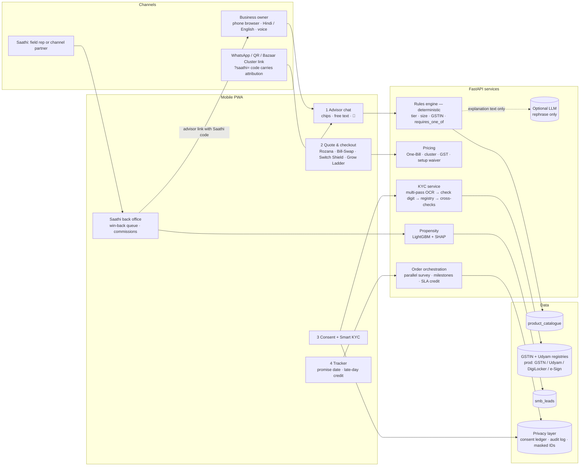

# Architecture — Ek Baithak

## Data flow
owner or link → advisor profile → rules engine + catalogue → quote → consent ledger → KYC
(OCR → GSTIN check digit & repair → registry lookup → name / date / PIN / signatory checks → verdict)
→ order (survey booked at checkout) → tracker. Unclosed sessions and dropped leads → propensity model
→ Saathi queue → advisor link back to the owner, with the Saathi's code for commission.

## Design rule
The catalogue rules decide **what** is sold; language models only decide **how** it is explained.
Recommendations are therefore auditable, compliant, and identical for the same input in every live test.

## Production swaps
| Demo | Production |
|---|---|
| CSV registries | GSTN, Udyam, DigiLocker pull, e-Sign via signed server-to-server APIs |
| JSON store in `.state/` | Encrypted database (AES-256 at rest), secrets in a vault |
| Browser speech recognition | Missed-call → WhatsApp voice notes in 10+ languages |
| Demo clock | Real install slots per city |
